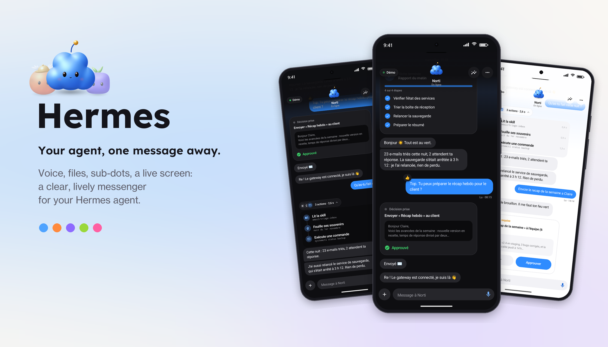
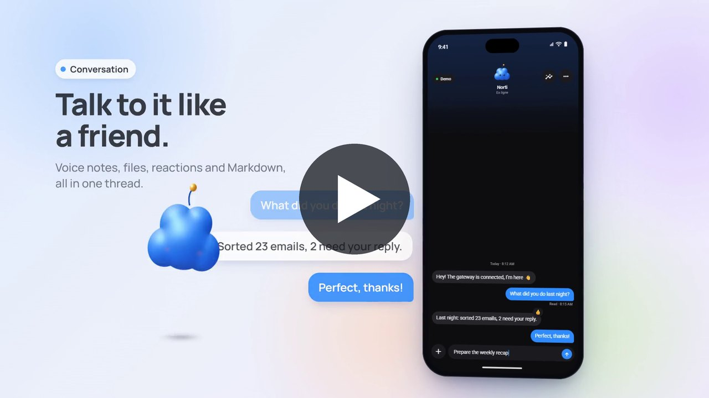
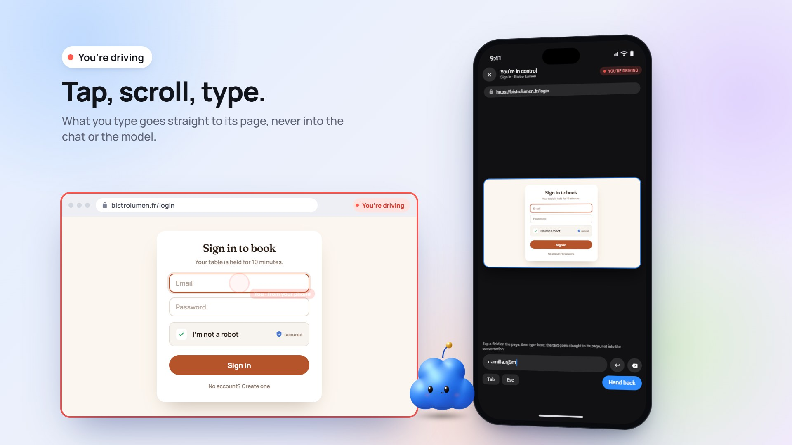
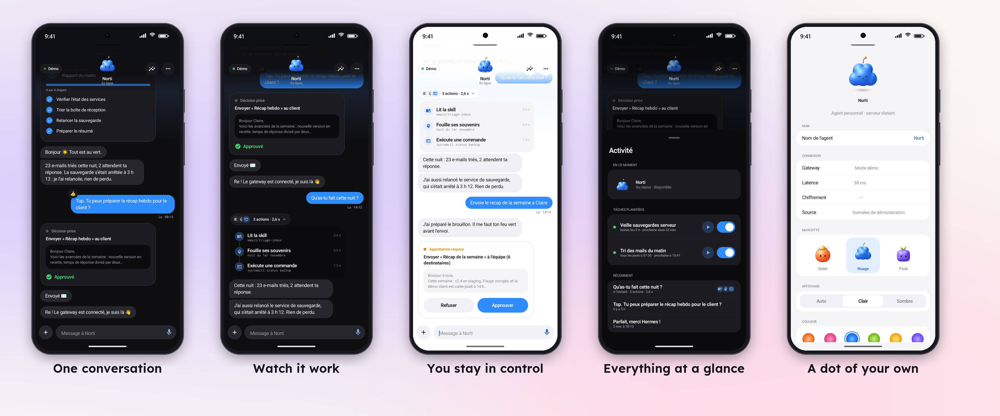
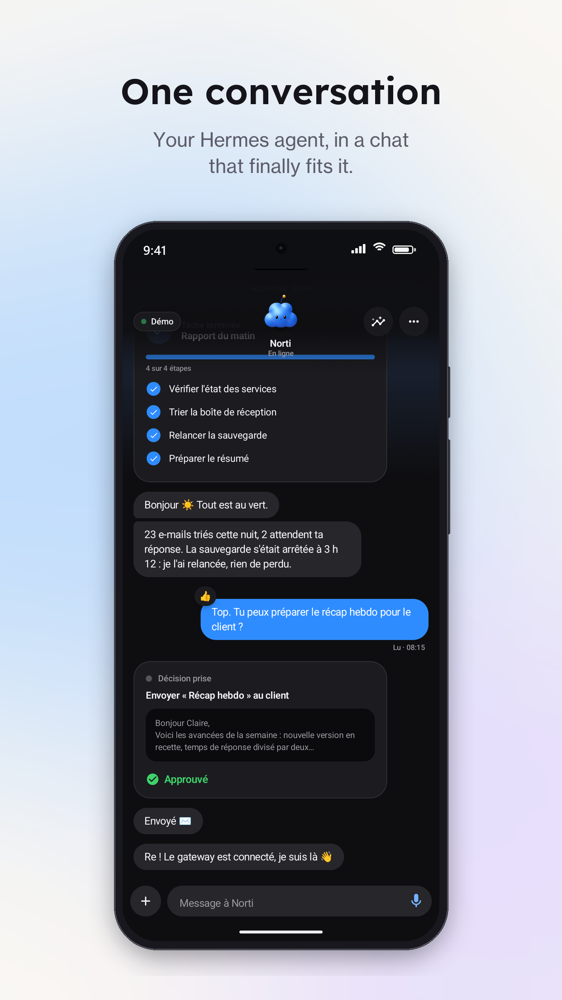
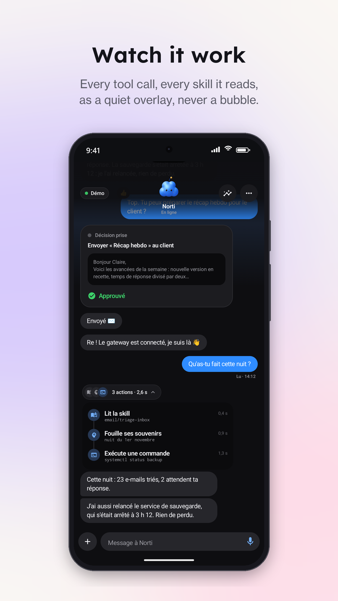
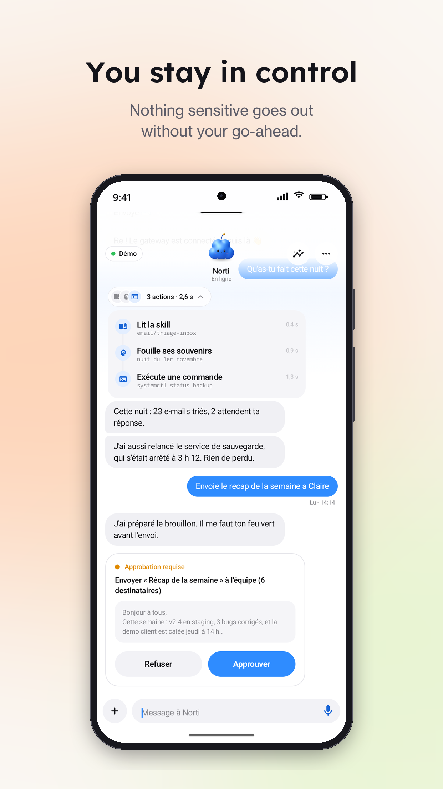
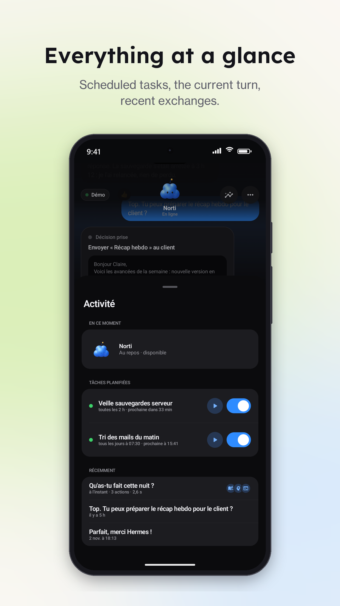
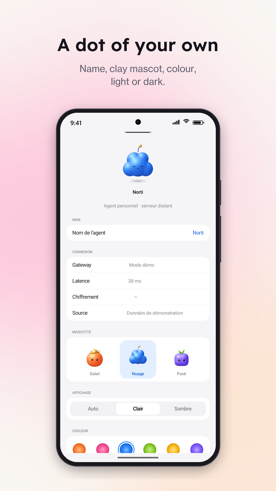

<p align="center">
  
</p>

# Hermes

**A native Android messenger for your [Hermes Agent](https://hermes-agent.nousresearch.com).**
Chat with your self-hosted agent the way you chat with a friend: voice notes, files, live tool activity,
approvals straight from a notification, a live view of its browser, and clay mascots you can make your own.

The project has two parts that work together:

| Part | What it is | Where |
|---|---|---|
| **Android app** | Kotlin + Jetpack Compose client | [`app/`](app) |
| **Gateway plugin** | A Hermes platform plugin (`dots-platform`) that exposes one authenticated WebSocket | [`server/hermes-plugin-dots/`](server/hermes-plugin-dots) |

The app speaks **English** and **French** and follows your phone's language: see [Languages](#languages).

---

## Table of contents

- [Video](#video)
- [Takeover demo](#takeover-demo)
- [Screenshots](#screenshots)
- [Features](#features)
  - [Stable](#stable)
  - [Experimental](#experimental)
  - [Roadmap](#roadmap)
- [Languages](#languages)
- [How it works](#how-it-works)
- [Requirements](#requirements)
- [1. Install the gateway plugin](#1-install-the-gateway-plugin)
- [2. Expose the gateway over HTTPS](#2-expose-the-gateway-over-https)
- [3. Build and install the Android app](#3-build-and-install-the-android-app)
- [4. Connect the app to your gateway](#4-connect-the-app-to-your-gateway)
- [Optional: push notifications](#optional-push-notifications)
- [Optional: voice notes](#optional-voice-notes)
- [Updating](#updating)
- [Releases (CI)](#releases-ci)
- [Troubleshooting](#troubleshooting)
- [Security notes](#security-notes)
- [Project structure](#project-structure)
- [Documentation](#documentation)
- [License](#license)

---

## Video

A 27-second tour: how the app and the gateway fit together, pairing, a conversation, approvals,
sub-dots and media, and making the mascot your own.
Click the image to play it (with sound).

<p align="center">
  <a href="assets/demo.mp4">
    
  </a>
</p>

---

## Takeover demo

A 20-second look at the [live browser screen and takeover](#experimental): your agent books a table,
hits a sign-in page and asks for help; you take over its browser from your phone, sign in, and hand it
back so it can finish the booking. What you type goes to its page only, never to the chat or the model.
Click the image to play it (with sound).

<p align="center">
  <a href="assets/takeover.mp4">
    
  </a>
</p>

---

## Screenshots

<p align="center">
  
</p>

<table>
  <tr>
    <td></td>
    <td></td>
    <td></td>
  </tr>
  <tr>
    <td></td>
    <td></td>
    <td></td>
  </tr>
</table>

*All screenshots come from the built-in demo mode.*

---

## Features

### Stable

Used daily and tested end to end against Hermes Agent 0.22.

**Conversation**
- One private conversation with your agent, with delivery receipts (*sending → sent → read*).
- Emoji reactions in both directions (long press or double tap).
- Full Markdown in agent replies: headings, nested and numbered lists, checklists, quotes, tables,
  code blocks with a copy button, clickable links.
- History stored on the gateway (SQLite) and loaded page by page as you scroll up.
- Messages typed offline are sent as soon as the connection comes back.

**Your agent at work**
- **Tool overlays**: each tool call or skill the agent reads appears as a small capsule above its reply,
  never as a chat bubble. Tap it to see the full timeline, with durations and failures.
- **Approvals**: sensitive commands wait for your go-ahead, from the chat or straight from the notification.
- **Clarifying questions** from the agent, answered with one tap.
- **Activity view**: a GitHub-style heatmap of the month's usage (tokens or messages, darker on busier
  days, browse back month by month, tap a day for its numbers), what the agent is doing now (with a
  *Stop* button), its scheduled tasks (pause, resume, run now) and recent exchanges.

**Media**
- **Voice notes**: record, replay with a waveform, and see what the agent heard (transcribed on your
  server by Whisper; see [voice notes](#optional-voice-notes)).
- **Files and photos in both directions**: send a picture or a PDF; receive images, documents or
  audio the agent produces.

**Notifications** (requires your own Firebase project, see [push notifications](#optional-push-notifications))
- A conversation-style notification when the app is in the background, with **quick reply**.
- Approval requests get their own notification with *Approve* / *Decline* buttons.

**Look and feel**
- Three original clay mascots (*Pebble*, *Cloud*, *Cobble*), six colours, an optional accessory,
  and a custom name for your agent.
- Light, dark or system theme.
- **Demo mode**: try the whole interface without a gateway.

### Experimental

These work, but rely on Hermes internals or are recent. Expect rough edges.

| Feature | Status |
|---|---|
| **Live browser screen** | Watch the agent's browser in real time (about 3 frames per second, only while you watch). Uses Hermes' in-process CDP seam for plugins, an internal API that may change between Hermes versions. |
| **Take over the browser** | When a page needs a human (login, 2FA, captcha), the agent hands you its browser; you tap, scroll and type on its page from your phone, then hand it back. Input is validated on Chromium; the agent must call the `browser_request_takeover` tool, which is not guaranteed. What you type goes to the page only, never to the chat or the model. |
| **Sub-dots** | Extra agents next to your main one, each with its own conversation and Hermes session: **temporary** ones for a single mission, **permanent** ones with their own name, specialty, mascot and colour. Swipe the mascot to switch. |
| **Group room** | From the *+* menu, invite sub-dots into the current conversation: they debate each of your messages for two rounds, each with its mascot above its bubbles, then the conversation's own dot concludes. Each guest speaks in a separate Hermes session, so its private conversation stays untouched. *Stop* ends the whole debate. |
| **Several devices at once** | The gateway accepts several connected apps and broadcasts the conversation to all of them. |

#### Group room

Ask several of your agents at once and watch them talk it through:

1. Tap **+** under the conversation, then **Group room**.
2. Tick the sub-dots to invite (up to four). The number next to each one is its turn to speak.
3. Tap **Open the room**. A banner above the message field shows who is in the room; its **×** closes it.
4. Send a message. Each guest answers in turn for two rounds and sees what the others just said. Its
   mascot and name sit above its bubbles, and the header says who has the floor. Then the
   conversation's own dot sums up and gives a conclusion.

Each guest speaks in its own Hermes session for that room, so its private conversation stays as it was,
and it remembers earlier debates in the same room. Tools, approvals and takeovers requested by a guest
show up in the room under its name. Only the conclusion sends a push notification. *Stop* (Activity
view) ends the whole debate.

### Roadmap

Checked items are done; the rest is not built yet.

- [ ] More languages for the app interface (English and French are done, see [Languages](#languages))
- [x] Prebuilt, signed APK attached to GitHub releases, with [in-app updates](#app-updates-from-github-releases)
- [x] One-command server install script ([`server/install.sh`](server/install.sh))
- [ ] Push notifications for everyone using the prebuilt APK, without sharing a Firebase server key:
  [UnifiedPush](https://unifiedpush.org) (ntfy) first, then possibly an optional hosted FCM relay that
  only sends content-free wake-ups (the app fetches the message from its own gateway)
- [ ] Protection against token brute force on the gateway
- [ ] Spoken replies, then hands-free voice calls with the agent
- [ ] Local message cache with full-text search
- [ ] A screen to review and edit what the agent remembers about you
- [ ] *Share to Hermes* from any Android app, and a home-screen widget

---

## Languages

The whole app interface is translated, demo mode included:

| Language | Status |
|---|---|
| 🇬🇧 English | ✅ Complete (default) |
| 🇫🇷 Français | ✅ Complete |

There is no language setting in the app: it **follows your phone's language**. A phone set to French
shows the app in French; any other language falls back to English. On Android 13 and later you can
also pick a language for Hermes alone, in *Settings › Apps › Hermes › Language*.

The agent's own replies are not translated by the app: Hermes answers in whatever language you write
to it. Tool labels sent by the gateway plugin are shown in the app's language for every tool the app
knows.

To add a language, copy `app/src/main/res/values/strings.xml` to `values-<code>/strings.xml`
(for example `values-de/`), translate the texts, and add the code to
`app/src/main/res/xml/locales_config.xml`.

---

## How it works

```
 Android app ── wss:// (TLS) ──▶ reverse proxy ──▶ dots-platform plugin ──▶ Hermes gateway ──▶ agent
     ▲                         (Caddy, /dots/ws)    127.0.0.1:8787
     └──────────── FCM push (optional) ◀───────────────────┘
```

- The plugin listens on **localhost only** (`127.0.0.1:8787`). A reverse proxy adds TLS and exposes
  just the `/dots/ws` path.
- The app authenticates with a **bearer token** (`DOTS_TOKEN`). Whoever holds it is the owner of the
  conversation.
- Everything is JSON frames over a single WebSocket. The full protocol is documented in
  [`docs/protocole-gateway.md`](docs/protocole-gateway.md) (in French).

---

## Requirements

| | Version |
|---|---|
| Hermes Agent | **0.22.x** (tested on 0.22.2), running as a gateway (`hermes gateway`) |
| Server | A public domain name (or Tailscale), a reverse proxy with TLS |
| Android device | Android **8.0+** (API 26) |
| To build the app | JDK 17 (Android Studio's bundled JBR works), Android SDK 36 |
| Optional | A Firebase project (push notifications), ~1 GB of free RAM on the server (voice notes) |

---

## 1. Install the gateway plugin

On the machine that runs Hermes, clone this repository and run the installer:

```bash
git clone <this repository> hermes-dots && cd hermes-dots
bash server/install.sh --domain hermes.example.com
```

It copies the plugin into `~/.hermes/plugins/dots`, enables it, fills in the missing `DOTS_*`
settings in `~/.hermes/.env` (with a fresh random token), turns tool activity into overlays,
restarts the gateway and checks that the plugin answers. It ends by printing your gateway address,
your token and a ready-to-use Caddyfile for [step 2](#2-expose-the-gateway-over-https).

The script is safe to run again, for instance to update the plugin. It backs up the previous plugin
and `.env` to `~/.hermes/backups/`, and it never overwrites an existing token or listen address
unless you ask it to.

| Option | Effect |
|---|---|
| `--domain NAME` | Print the `wss://` address and a Caddyfile for this domain |
| `--voice [tiny\|base\|small]` | Also set up [voice notes](#optional-voice-notes) (default model: `small`) |
| `--stt-language LANG` | Transcription language (default `fr`; `""` for auto-detect) |
| `--fcm-key FILE` | Install the Firebase key for [push notifications](#optional-push-notifications) |
| `--bind HOST:PORT` | Local listen address (default `127.0.0.1:8787`) |
| `--rotate-token` | Generate a new token (the app will need to be paired again) |
| `--no-restart` | Leave the gateway running; restart it yourself |
| `--dry-run` | Show what would be done, change nothing |

`HERMES_HOME` (default `~/.hermes`) and `HERMES_BIN` (default: `hermes` from your `PATH`) select
another installation.

<details>
<summary>Manual installation</summary>

```bash
# 1. Copy the plugin into your Hermes plugins folder
mkdir -p ~/.hermes/plugins/dots
cp server/hermes-plugin-dots/{plugin.yaml,__init__.py,adapter.py} ~/.hermes/plugins/dots/

# 2. Enable it (plugins are opt-in)
hermes plugins enable dots-platform
```

Add the plugin settings to `~/.hermes/.env`:

```bash
# Long random token: the app's only credential
DOTS_TOKEN=$(openssl rand -hex 24)
# Where the WebSocket listens (keep it on localhost, behind the reverse proxy)
DOTS_BIND=127.0.0.1:8787
# Single owner; cron jobs and proactive messages land in the main conversation
DOTS_ALLOWED_USERS=owner
DOTS_HOME_CHANNEL=owner
```

Show tool activity as overlays instead of text bubbles:

```bash
hermes config set display.platforms.dots.tool_progress off
```

Restart the gateway and check that the plugin is listening:

```bash
systemctl --user restart hermes-gateway
curl -s http://127.0.0.1:8787/dots/health   # → {"ok": true}
```

</details>

> [!IMPORTANT]
> Do not keep a backup copy of the plugin **inside** `~/.hermes/plugins/`: Hermes may load the backup
> instead of your new version, since both declare the same plugin name.

---

## 2. Expose the gateway over HTTPS

The app only connects over `wss://`. Any reverse proxy with WebSocket support works. Here is a
minimal [Caddy](https://caddyserver.com) configuration that gets a Let's Encrypt certificate
automatically and exposes **only** the WebSocket path:

```caddyfile
hermes.example.com {
	handle /dots/ws {
		reverse_proxy 127.0.0.1:8787
	}
	handle {
		respond 404
	}
}
```

If you run Caddy in Docker, use host networking so it can reach `127.0.0.1:8787`:

```bash
docker run -d --name hermes-caddy --network host --restart unless-stopped \
  -v $PWD/Caddyfile:/etc/caddy/Caddyfile \
  -v caddy_data:/data -v caddy_config:/config caddy:2
```

> [!TIP]
> No domain name? A free [sslip.io](https://sslip.io) hostname built from your server's IP
> (e.g. `203-0-113-7.sslip.io`) works with Caddy. Or keep everything private with
> [Tailscale](https://tailscale.com) and its HTTPS certificates.

Your gateway address is then `wss://hermes.example.com/dots/ws`.

---

## 3. Build and install the Android app

### Download a release

Every push to `main` builds an APK and publishes it on the repository's **Releases** page
(`hermes-<version>.apk`, with its SHA-256). Open the page on your phone, download the APK and allow
installation from your browser when Android asks.

> [!NOTE]
> A release APK has push notifications only if the repository owner configured Firebase for the
> build (the release notes say so). Push notifications are tied to one Firebase project: to get them
> with your own server, build the app yourself or fork the repository with your own secrets
> (see [Releases (CI)](#releases-ci)).

### Build from source

```bash
git clone <this repository>
cd <repository>
```

Without `app/google-services.json` the app builds and works fully, with push notifications turned
off. Add the file to turn them on (see [push notifications](#optional-push-notifications)).

Build and install over USB or wireless debugging:

```bash
./gradlew assembleDebug
adb install -r app/build/outputs/apk/debug/app-debug.apk
```

On Windows, point `JAVA_HOME` at Android Studio's JDK if needed:

```bash
export JAVA_HOME="C:/Program Files/Android/Android Studio/jbr"
```

You can also open the project in Android Studio and press **Run**.

---

## 4. Connect the app to your gateway

1. Open **Hermes** on your phone.
2. In **Gateway**, enter your address: `wss://hermes.example.com/dots/ws`.
3. In **Jeton** (token), paste the value of `DOTS_TOKEN`.
4. Tap **Se connecter**.

The app remembers the pairing on this device only and reconnects on its own after network changes.
Your conversation history is loaded from the gateway.

> [!TIP]
> Want to look around first? Tap **Essayer en mode démo** on the same screen: a simulated agent shows
> every kind of message, no gateway needed.

---

## Optional: push notifications

Notifications use **Firebase Cloud Messaging**. The gateway sends data-only messages; the app builds
the notification itself (conversation style, quick reply, approval buttons).

1. Create a project in the [Firebase console](https://console.firebase.google.com) and add an
   **Android app** with the package name `app.dotshermes`.
2. Download `google-services.json` into `app/` and rebuild the app.
3. In Google Cloud, create a **service account** with the role *Firebase Cloud Messaging API Admin*
   (`roles/firebasecloudmessaging.admin`) and download a JSON key.
4. Copy the key to the server, readable by its owner only:

   ```bash
   bash server/install.sh --fcm-key key.json
   # or by hand:
   install -m 600 key.json ~/.hermes/platforms/dots/fcm-service-account.json
   ```

   (Another path can be set with `DOTS_FCM_CREDENTIALS`.)
5. Restart the gateway. Its log line ends with `(push on)`.

The gateway only pushes when no connected app is in the foreground.

> [!NOTE]
> An APK built with your `google-services.json` only receives notifications sent with *your* service
> account: each person who builds the app needs their own Firebase project.

---

## Optional: voice notes

Voice notes are transcribed **on your server** by Hermes' own speech-to-text pipeline, with a local
Whisper model. No audio leaves the server.

```bash
bash server/install.sh --voice small --stt-language fr
```

or by hand:

```bash
hermes pm install --extra stt-whisper     # installs faster-whisper into Hermes' environment
hermes config set stt.local.model small   # good quality / speed balance on a small VPS
hermes config set stt.language fr         # or "en", or "" for auto-detect
systemctl --user restart hermes-gateway
```

`small` needs roughly 700 MB of RAM while transcribing (about 4 s for a 6 s clip on 2 vCPUs).
On a tight server, use `base`, or add some swap.

---

## Updating

```bash
# Gateway plugin: keeps your token and settings, backs up the previous version
git pull && bash server/install.sh

# App (built from source): rebuild and reinstall
./gradlew assembleDebug && adb install -r app/build/outputs/apk/debug/app-debug.apk
```

The plugin migrates its own data (history and sub-dots live in `~/.hermes/platforms/dots/`).

### App updates from GitHub releases

An APK installed from [Releases](https://github.com/Drevero/Dots-hermes/releases) **updates itself**, no store needed:

- It checks the repository's latest release when it opens and twice a day in the background, and
  sends a notification when a new version is out.
- One tap downloads the APK, checks it against the SHA-256 published with the release, and hands it to
  Android. The first time, Android asks you to allow Hermes to install apps; after that, each update
  is a single confirmation. On Android 12+, once Hermes has updated itself once, later updates may
  install without any prompt.
- Your conversations and settings stay: it installs over the current version.
- *Settings › App › Version* shows the installed version and checks on demand.

Prefer fully automatic updates? [Obtainium](https://github.com/ImranR98/Obtainium) can track this
repository's releases (APK filter: `\.apk$`) and install them in the background.

Builds made from source (debug builds, or release builds without `UPDATE_REPO`) never update
themselves: their signing key differs from the releases'.

> [!WARNING]
> Android only installs an update signed with the same key as the installed app. Moving between a
> locally built APK and a release APK (or between debug-signed and release-signed builds) requires
> uninstalling first, and the app will need to be paired again.

---

## Releases (CI)

[`.github/workflows/android-release.yml`](.github/workflows/android-release.yml) runs on every push
to `main` that touches the app (changes limited to docs, design or `server/` are skipped), or by
hand from the **Actions** tab. It runs the unit tests, builds a release APK and publishes it as a
GitHub release tagged `v<appVersionName>.<run number>`.

The version name comes from `appVersionName` in [`gradle.properties`](gradle.properties); the
version code grows with each run, so phones accept each new release as an update.

Everything below is optional: without it, the workflow still publishes a working APK.

| Secret / variable | Purpose |
|---|---|
| `GOOGLE_SERVICES_JSON` | `app/google-services.json` encoded in base64: turns on push notifications |
| `SIGNING_KEYSTORE_BASE64` | Your release keystore (`.jks`) in base64 |
| `SIGNING_STORE_PASSWORD`, `SIGNING_KEY_ALIAS`, `SIGNING_KEY_PASSWORD` | Its passwords and key alias |
| `DEFAULT_GATEWAY_URL` (variable) | Gateway address pre-filled on the pairing screen |

The workflow also sets `UPDATE_REPO` to the repository it runs in, so the in-app updater of a fork
follows that fork's releases.

Without the signing secrets, the APK is signed with a throwaway debug key generated on the build
machine. It installs fine, but each release may be signed differently, so **updates (in-app or
Obtainium) fail** until you set a stable key. Create a key once and add it as secrets:

```bash
keytool -genkeypair -v -keystore release.jks -alias hermes -keyalg RSA -keysize 4096 -validity 10000
base64 -w0 release.jks          # → SIGNING_KEYSTORE_BASE64
base64 -w0 app/google-services.json   # → GOOGLE_SERVICES_JSON
```

Keep `release.jks` and its passwords safe: losing them means every user must reinstall the app.

---

## Troubleshooting

| Symptom | Likely cause and fix |
|---|---|
| *Jeton refusé par le gateway* | The token in the app does not match `DOTS_TOKEN`. Check `~/.hermes/.env`, then restart the gateway after any change. |
| *Aucun gateway Dots à cette adresse* | The reverse proxy answers but the path is wrong: the address must end with `/dots/ws`. |
| *Gateway injoignable* | TLS or DNS issue, or the plugin is not running: test `curl http://127.0.0.1:8787/dots/health` on the server. |
| Tool steps appear as text bubbles | Run `hermes config set display.platforms.dots.tool_progress off` and restart. |
| Changes to the plugin are ignored | A copy of the plugin sits elsewhere in `~/.hermes/plugins/`; remove it. |
| No notifications | Check for `(push on)` in the gateway log, the notification permission on the phone, and that the app was built with *your* `google-services.json`. |
| Voice notes are not understood | `hermes pm install --extra stt-whisper` was not run, or the STT language is wrong. |
| The live screen stays empty | The agent has no open browser right now. Hermes closes its browser at the end of each turn. |

---

## Security notes

- The **token is the only credential**: use a long random value, and never commit it.
- The plugin binds to `127.0.0.1`; only the reverse proxy should be reachable from outside, and it
  should expose nothing but `/dots/ws`.
- Approvals and browser takeover keep **you** in the loop. Text typed during a takeover goes straight
  to the agent's page and is never stored in the conversation or sent to the model.
- Keep the Firebase service-account key on the server only (`chmod 600`). It must never be shipped in
  the app or committed.
- Sub-dot conversations are deleted from the gateway when you close the dot.

---

## Project structure

```
app/                          Android app (Kotlin, Jetpack Compose)
└── src/main/kotlin/app/dotshermes/
    ├── data/                 gateway client, protocol, demo agent, models
    ├── push/                 FCM service, notifications, quick reply, approvals
    ├── voice/                recorder and player for voice notes
    ├── attach/               attachments (import, preview, open)
    └── ui/                   chat, mascots, sub-dots, activity, live screen, theme
server/hermes-plugin-dots/    Hermes platform plugin (aiohttp WebSocket, SQLite history, FCM)
server/install.sh             one-command plugin installer / updater
.github/workflows/            release pipeline (APK built and published on push to main)
design/mascotte/              mascot renderer (Python) and renders
design/mockups/               screenshot mockups generator
docs/                         gateway protocol (French)
assets/                       images used in this README
```

Run the unit tests with:

```bash
./gradlew testDebugUnitTest
```

---

## Documentation

- [Gateway protocol](docs/protocole-gateway.md): every frame, history, attachments, live screen,
  takeover, sub-dots, group room, push (French).

---

## License

Hermes is free software, released under the [GNU General Public License v3.0](LICENSE): you can use,
study, share and modify it, and any distributed version, modified or not, must stay under the same
license with its source code available.
